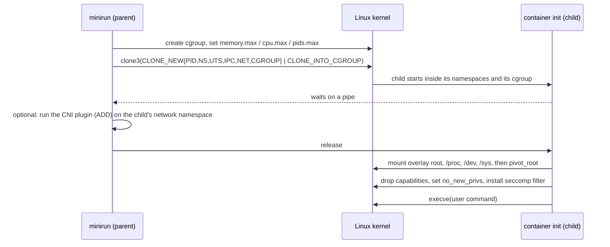

<div align="center">

# minirun

**A container runtime and a Kubernetes CNI network plugin, written from scratch in Go on raw
Linux primitives: namespaces, cgroups v2, overlayfs, pivot_root, capabilities, a hand-assembled
seccomp BPF filter, veth pairs and bridges.**

[](https://github.com/vik-bit/minirun/actions/workflows/ci.yml)


</div>

---

## At a glance

| | |
|---|---|
| **What it is** | `minirun` starts a process in its own namespaces, cgroup and root filesystem, like a minimal `runc`. `minicni` is a CNI 1.0 plugin plus a node daemon: it is the **only** network plugin of a three-node Kubernetes cluster, and gives every pod an address and a route to every other pod. |
| **Why build it** | Docker and Kubernetes networking look like magic until you build them. This project builds the pieces underneath: the system calls a runtime makes, and the plumbing a CNI plugin creates for each pod. |
| **Results** | Same-design parity with Flannel (host-gw): **24 Gbit/s and 171 µs** cross-node, against Flannel's 24.5 Gbit/s and 174 µs. Flannel's default VXLAN mode reaches only 13.2 Gbit/s and 218 µs on the same cluster. Containers start and exit in **9 ms** (median, against runc's 48 ms). [Details ↓](#results) |
| **Verified by** | 11 unit tests, **14 integration tests on real containers**, and an **end-to-end test on a 3-node Kind cluster**, all run in CI on every push. |
| **Skills shown** | Linux internals (namespaces, cgroups v2, mounts, capabilities) · seccomp and classic BPF · Linux networking (netlink, veth, bridges, routing, iptables) · the CNI specification · Kubernetes node networking · benchmarking · Go systems programming |

---

## Results

### Pod-to-pod network (three-node Kind cluster, 5 repetitions)

Throughput is iperf3 for 10 s. Latency is a 1-byte TCP request/response loop for 10 s (the same
measurement as netperf's `TCP_RR`). Cells show the median and, in brackets, the range.

| CNI | Path | Throughput, Gbit/s | Latency p50, µs | Latency p99, µs |
|---|---|---|---|---|
| **minicni** (host-gw) | cross-node | **24.1** (22.8–25.2) | **171** (170–179) | 511 (460–545) |
| Flannel host-gw | cross-node | 24.5 (21.4–24.7) | 174 (171–199) | 544 (528–579) |
| Flannel VXLAN (default) | cross-node | 13.2 (13.1–13.8) | 218 (213–221) | 581 (550–599) |
| **minicni** | same-node | **35.5** (35.3–36.6) | **145** (140–151) | 462 (448–471) |
| Flannel host-gw | same-node | 35.1 (31.7–35.3) | 152 (147–192) | 492 (470–554) |
| Flannel VXLAN (default) | same-node | 26.9 (26.4–27.3) | 180 (179–181) | 466 (458–489) |

**What this shows:**
- **minicni matches Flannel when both use the same design** (host-gw: plain routes, no
  encapsulation). The ranges overlap, so neither is faster; the point is that a from-scratch
  plugin reaches a production plugin's data-path performance.
- **Encapsulation is the real cost.** Flannel's default VXLAN mode wraps every packet in UDP.
  It loses about 45% of cross-node throughput and adds about 28% to median latency.
- **VXLAN slows same-node traffic too**, though that traffic never enters the tunnel. Flannel
  lowers every pod's MTU to 1450 to leave room for the 50-byte VXLAN header, so local traffic
  moves in smaller packets.
- The trade-off: host-gw needs all nodes on one layer-2 network, and VXLAN works across routed
  networks. minicni only supports the first.

### Container start time (`/bin/true`, 50 interleaved runs)

| Runtime | Median | p95 |
|---|---|---|
| runc 1.1.5 (`runc spec` default bundle) | 48.2 ms | 69.5 ms |
| **minirun** (with seccomp) | **9.2 ms** | 14.9 ms |
| minirun (no seccomp) | 8.2 ms | 22.3 ms |

minirun does much less than runc: no OCI configuration parsing, no state directory, no hooks.
runc also re-executes itself through a C setup stage. So this shows the cost of the essential
steps, not that minirun is a better runc. The seccomp filter costs about 1 ms.

All numbers are from one laptop (Intel i7-1255U, Docker Desktop on WSL2). Scripts and raw data:
[`scripts/`](scripts/) and [`bench/results/`](bench/results/).

---

## How it works

### The runtime: `minirun run`



```bash
minirun run --image ./alpine-rootfs --memory 64M --cpus 0.5 --pids 64 -- /bin/sh
```

### The network: `minicni`

```
 node A (10.244.1.0/24)                          node B (10.244.2.0/24)
 ┌───────────────────────────────┐               ┌───────────────────────────────┐
 │ pod  eth0 10.244.1.5          │               │ pod  eth0 10.244.2.7          │
 │        │ veth pair            │               │        │ veth pair            │
 │ bridge mcni0 10.244.1.1       │               │ bridge mcni0 10.244.2.1       │
 │ route 10.244.2.0/24 via B ────┼── node LAN ───┼── route 10.244.1.0/24 via A   │
 └───────────────────────────────┘               └───────────────────────────────┘
```

- **The plugin** runs once per pod, when the kubelet calls it. It creates the node's bridge if
  needed, then a veth pair, moves one end into the pod as `eth0`, and assigns an address and a
  default route.
- **The daemon** runs on every node as a DaemonSet ([`deploy/minicni.yaml`](deploy/minicni.yaml)).
  It installs the plugin, writes the CNI config for the node's pod subnet, and keeps one route
  per other node. From the end-to-end run:

  ```
  10.244.0.0/24 via 172.23.0.4 dev eth0 proto 199
  10.244.1.0/24 via 172.23.0.3 dev eth0 proto 199
  10.244.2.0/24 dev mcni0 proto kernel scope link src 10.244.2.1
  ```

---

## Design decisions

| Decision | Why |
|---|---|
| Start the child **directly inside its cgroup** (`clone3` with `CLONE_INTO_CGROUP`) | No instruction runs outside the limits, and there is no window between "process exists" and "process is limited". |
| The child **waits on a pipe** until the parent has set up its cgroup and network | The user's command can never start before its limits and interfaces exist. |
| `pivot_root`, not `chroot`, then detach the old root | `chroot` can be escaped. `pivot_root` leaves the host filesystem unreachable from inside. |
| **Seccomp filter hand-assembled as classic BPF**, not loaded from a library | The deny list is modelled on Docker's default profile. It also handles three easy-to-miss cases: it **rejects other architectures**, **blocks the x32 ABI**, and **checks `clone` flags** so new namespaces can't be created. `clone3` gets `ENOSYS`, so the C library falls back to `clone`, whose flags the filter can read. |
| Drop capabilities from the **bounding set**, on the same OS thread that execs | For a root process, the bounding set is what survives `execve`. Capabilities are per thread, and Go is multi-threaded. |
| Handle cgroup v2's **"no internal processes" rule** by moving existing processes to a leaf group *before* enabling any controller | Needed inside Docker and Kind, whose root cgroup holds processes. The order matters. Once a controller is on, new child groups can no longer accept processes. A first version got this wrong and the integration tests caught it. |
| **IP allocation as one file per address, under `flock`** | Each CNI call is a separate process, and the kubelet runs several at once. On-disk state survives plugin restarts. |
| **Round-robin** allocation, not lowest-free | A freed address isn't handed to a new pod while other nodes may still cache it in ARP or connection tracking. |
| **DEL is idempotent** | The kubelet repeats DEL after failures and reboots. The CNI spec requires it. |
| The daemon talks to the Kubernetes API with **plain HTTPS and the service-account token** | No client library: the one API call it needs (list nodes) fits in about 40 lines. |
| Routes the daemon owns carry their **own route protocol number** (`proto 199`) | It can find and remove the routes for departed nodes without touching anyone else's. |

---

## Tests

| Level | What is tested | Count |
|---|---|---|
| **Unit** | The seccomp filter's decisions, run in a BPF interpreter (denied calls, allowed calls, `clone` flags, `clone3`, other architectures, x32). The IP allocator (reserved addresses, idempotency, no immediate reuse, wrap-around, 100 concurrent allocations, invalid subnets). | 11 |
| **Integration**: real containers from an Alpine image ([`tests/integration`](tests/integration/)) | PID 1 in its own PID namespace · own hostname · writes stay in the container layer · capabilities exactly match Docker's default set (`a80425fb`) · `mount` refused · **seccomp shown to be the deciding layer:** creating a user namespace succeeds without the filter and fails with it, by both `unshare` and `clone` · `/proc/kcore` masked, sysctls read-only · memory limit triggers the OOM killer (exit 137) · pids limit stops a fork bomb · CPU limit of 0.2 slows a busy loop about 6× · loopback only without a network · **two containers get addresses from minicni and ping each other**, and both addresses are freed afterwards | 14 |
| **End to end**: 3-node Kind cluster, minicni as its only CNI ([`scripts/kind-e2e.sh`](scripts/kind-e2e.sh)) | All nodes Ready · CoreDNS running · same-node and cross-node pod ping · HTTP through a Service by DNS name | 1 script |

CI runs all three levels on every push, plus `gofmt`, `go vet`, the race detector and an ARM64
build.

---

## Run it yourself

Needs Docker. The scripts run everything that needs root inside privileged containers or Kind
nodes, so they also work from macOS or Windows.

```bash
scripts/integration.sh
```
```bash
scripts/kind-e2e.sh --keep
```
```bash
scripts/bench-net.sh minicni && scripts/bench-start.sh && python3 bench/summarize.py
```

`kind-e2e.sh` also needs `kind` and `kubectl`. On Linux, `go build ./cmd/minirun ./cmd/minicni`
builds the binaries; running `minirun` needs root and cgroups v2.

---

## Limitations and next steps

- **Layer 2 only.** minicni routes host-gw style, so nodes must share a network segment. An
  encapsulation mode would remove that limit, at the VXLAN cost measured above.
- **No NetworkPolicy, IPv6 or user namespaces** (containers run as root, limited by capabilities
  and seccomp).
- **minirun runs directories, not OCI images or bundles.**
- **Benchmarks:** one laptop, five repetitions, no Calico or Cilium yet, and no Service-scaling
  test. The next measurement would compare kube-proxy with iptables and with eBPF as the number
  of Services grows.

---

## Project layout

```
cmd/minirun/            runtime CLI (and the hidden child entry point)
cmd/minicni/            CNI plugin entry point, and `minicni daemon`
internal/container/     parent and child halves of starting a container
internal/cgroups/       cgroup v2 groups and limits
internal/caps/          capability dropping
internal/seccomp/       BPF filter, deny lists per architecture
internal/cni/           CNI 1.0 types, and the runtime side that invokes plugins
internal/plugin/        minicni ADD / DEL / CHECK: bridge, veth, address, routes, iptables
internal/ipam/          file-based IPv4 address allocator
internal/daemon/        node daemon: plugin install, CNI config, host-gw routes
deploy/                 DaemonSet manifest and Kind cluster config
tests/integration/      real-container tests and the in-container probe
bench/                  request/response tool, start-time timer, results
scripts/                integration, end-to-end and benchmark runners
```

Related: [Kubernetes CNI benchmarks](https://github.com/vik-bit/GROUP6_GRSPROJECT), the team
project that measured Flannel, Calico and Cilium, and the reason this one exists.

## License

MIT
