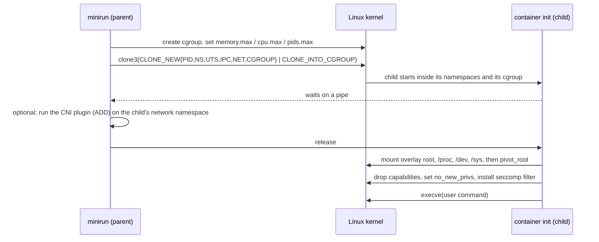

<div align="center">

# minirun

**A container runtime and a Kubernetes CNI network plugin, written from scratch in Go on raw
Linux primitives: namespaces, cgroups v2, overlayfs, pivot_root, capabilities, a hand-assembled
seccomp BPF filter, veth pairs and bridges.**

[](https://github.com/vik-bit/minirun/actions/workflows/ci.yml)


</div>

> **Status: work in progress.** Both components are fully written (~2,000 lines of Go) and build
> cleanly for x86-64 and ARM64. The seccomp filter and the IP allocator are covered by unit tests
> that pass in CI. **Running containers end to end, the Kubernetes integration and the benchmarks
> are not yet verified.** The [roadmap](#roadmap) lists what comes next. Every claim below about
> behaviour is about how the code is designed, unless it says *tested*.

---

## At a glance

| | |
|---|---|
| **What it is** | `minirun` starts a process in its own namespaces, cgroup and root filesystem, like a minimal `runc`. `minicni` is a CNI 1.0 plugin plus node daemon that gives every pod in a multi-node Kubernetes cluster an IP address and routes between nodes. |
| **Why build it** | Docker and Kubernetes networking look like magic until you build them. This project builds the pieces underneath: the system calls a runtime makes, and the plumbing a CNI plugin creates for each pod. |
| **Verified so far** | Builds and passes `go vet` on x86-64 and ARM64. **11 unit tests** pass under the race detector: the seccomp filter's decisions, run in a BPF interpreter, and the IP allocator, including 100 concurrent allocations. |
| **Skills shown** | Linux internals (namespaces, cgroups v2, mounts, capabilities) · seccomp and classic BPF · Linux networking (netlink, veth, bridges, routing, iptables) · the CNI specification · Kubernetes node networking · concurrency-safe on-disk state · Go systems programming |

---

## How it works

### The runtime: `minirun run`



```bash
minirun run --image ./alpine-rootfs --memory 64M --cpus 0.5 --pids 64 -- /bin/sh
```

### The network: `minicni`

```
 node A (10.244.1.0/24)                          node B (10.244.2.0/24)
 ┌───────────────────────────────┐               ┌───────────────────────────────┐
 │ pod  eth0 10.244.1.5          │               │ pod  eth0 10.244.2.7          │
 │        │ veth pair            │               │        │ veth pair            │
 │ bridge mcni0 10.244.1.1       │               │ bridge mcni0 10.244.2.1       │
 │ route 10.244.2.0/24 via B ────┼── node LAN ───┼── route 10.244.1.0/24 via A   │
 └───────────────────────────────┘               └───────────────────────────────┘
```

- **The plugin** runs once per pod, when the kubelet calls it. It creates the node's bridge if
  needed, then a veth pair, moves one end into the pod as `eth0`, and assigns an address and a
  default route.
- **The daemon** runs on every node as a DaemonSet. It installs the plugin, writes the CNI config
  for the node's pod subnet, and keeps one route per other node: "that node's pods are reachable
  via that node's IP". This is *host-gw* routing, as in Flannel's host-gw mode, so nodes must
  share a layer-2 network.

---

## Design decisions

| Decision | Why |
|---|---|
| Start the child **directly inside its cgroup** (`clone3` with `CLONE_INTO_CGROUP`) | No instruction runs outside the limits, and there is no window between "process exists" and "process is limited". |
| The child **waits on a pipe** until the parent has set up its cgroup and network | The user's command can never start before its limits and interfaces exist. |
| `pivot_root`, not `chroot`, then detach the old root | `chroot` can be escaped. `pivot_root` leaves the host filesystem unreachable from inside. |
| **Seccomp filter hand-assembled as classic BPF**, not loaded from a library | The deny list is modelled on Docker's default profile: module loading, mounting (old and new mount APIs), keyrings, clock changes, kexec, BPF and more. Plus three details that are easy to miss: **reject other architectures** (32-bit syscall numbers mean different calls), **block the x32 ABI** (it bypasses x86-64 numbering), and **check `clone` flags** so new namespaces can't be created. `clone3` gets `ENOSYS` so the C library falls back to `clone`, whose flags the filter can read. |
| Drop capabilities from the **bounding set**, on the same OS thread that execs | For a root process, the bounding set is what survives `execve`. Capabilities are per thread, and Go is multi-threaded. |
| Handle cgroup v2's **"no internal processes" rule** by moving existing processes to a leaf group | Without this, the runtime fails inside a Docker or Kind container, whose root cgroup already holds processes. `runc` and `systemd` do the same. |
| **IP allocation as one file per address, under `flock`** | Each CNI call is a separate process, and the kubelet runs several at once. On-disk state survives plugin restarts. |
| **Round-robin** allocation, not lowest-free | A freed address isn't handed to a new pod while other nodes may still cache it in ARP or connection tracking. |
| Hash the container id into the **veth name** | Names are stable (DEL and CHECK can find them) and fit Linux's 15-byte limit. |
| **DEL is idempotent** | The kubelet repeats DEL after failures and reboots, so deleting something already gone must succeed. The CNI spec requires it. |
| The daemon talks to the Kubernetes API with **plain HTTPS and the service-account token** | No client library: the binary stays small, and the one API call it needs (list nodes) is visible in about 40 lines. |
| Routes the daemon owns carry their **own route protocol number** | It can find and remove the routes for departed nodes without touching anyone else's. |

---

## Tests

| Package | What is tested | Status |
|---|---|---|
| `internal/seccomp` | The assembled filter, run in a BPF interpreter: every denied syscall returns `EPERM`; ordinary calls (`read`, `execve`, `socket`, `ptrace`) are allowed; `clone` is refused only with namespace flags; `clone3` returns `ENOSYS`; other architectures are killed; x32 calls are refused | ✅ 5 tests pass |
| `internal/ipam` | Skips the network, gateway and broadcast addresses; one address per container and interface (retries get the same one); release is idempotent; no immediate reuse of freed addresses; wrap-around; **100 concurrent allocations from separate stores never collide**; rejects IPv6 and tiny subnets | ✅ 6 tests pass |
| Runtime, plugin, daemon | End-to-end behaviour | ⏳ Not yet tested ([roadmap](#roadmap)) |

CI runs `gofmt`, `go vet`, a build and the tests under the race detector, plus an ARM64 vet and build.

---

## Build

Needs Go 1.23. Building works on any OS. **Running** needs Linux with cgroups v2, and root.

```bash
go build ./cmd/minirun ./cmd/minicni
```
```bash
go test -race ./...
```

No Linux machine? `Dockerfile.dev` gives a toolchain with the networking tools. Run it with
`--privileged` for anything that creates namespaces.

---

## Roadmap

1. **Integration tests in a privileged container:** PID 1 inside the container, hostname
   isolation, a memory limit that triggers the OOM killer, a pids limit that stops a fork bomb,
   seccomp refusing `mount` and `unshare`, and two network namespaces pinging across the bridge
   through the plugin.
2. **A multi-node Kind cluster with minicni as its only CNI:** the DaemonSet manifest, pods on
   different nodes reaching each other, and Services through kube-proxy.
3. **Benchmarks:** pod-to-pod latency and throughput against Flannel, and container start time
   against `runc`, with repeated runs.
4. User namespaces (run as an unprivileged user on the host), and running OCI bundles.

---

## Project layout

```
cmd/minirun/            runtime CLI (and the hidden child entry point)
cmd/minicni/            CNI plugin entry point, and `minicni daemon`
internal/container/     parent and child halves of starting a container
internal/cgroups/       cgroup v2 groups and limits
internal/caps/          capability dropping
internal/seccomp/       BPF filter, deny lists per architecture
internal/cni/           CNI 1.0 types, and the runtime side that invokes plugins
internal/plugin/        minicni ADD / DEL / CHECK: bridge, veth, address, routes, iptables
internal/ipam/          file-based IPv4 address allocator
internal/daemon/        node daemon: plugin install, CNI config, host-gw routes
```

Related: [Kubernetes CNI benchmarks](https://github.com/vik-bit/GROUP6_GRSPROJECT), the team
project that measured Flannel, Calico and Cilium, and the reason this one exists.

## License

MIT
